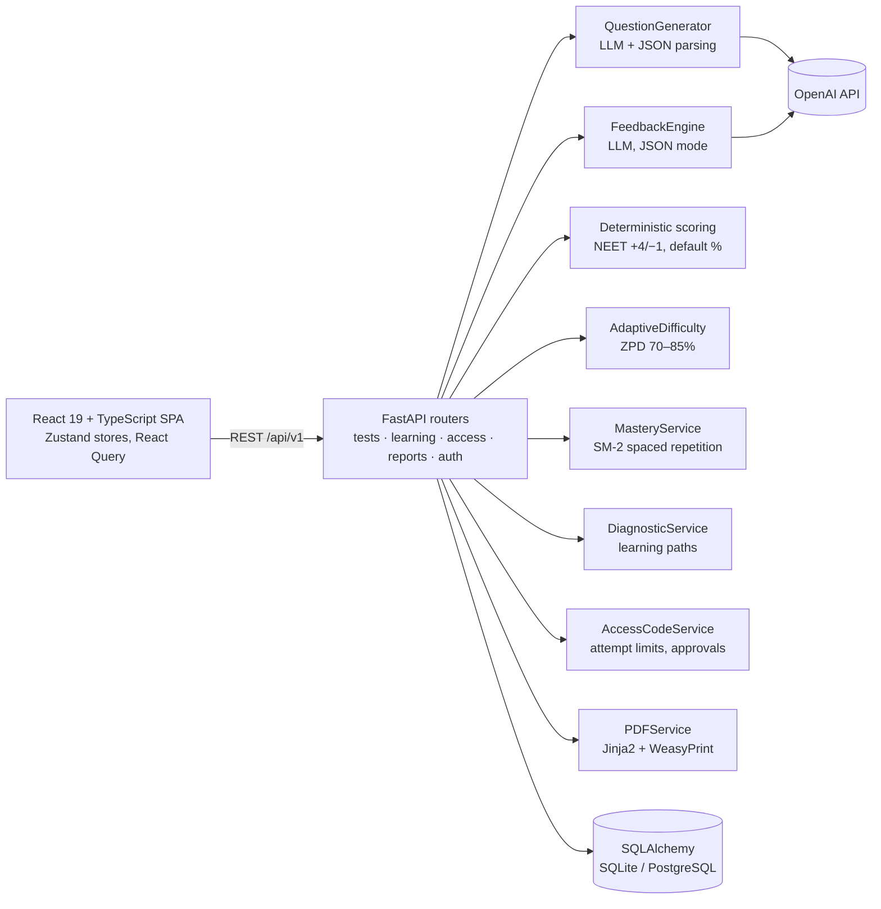

# AI Exam Builder

**AI-generated, standards-aligned practice exams with adaptive difficulty, spaced-repetition mastery tracking and AI feedback.**

A full-stack assessment platform: an LLM writes the questions and the feedback, while deterministic code does the scoring, difficulty adjustment, mastery tracking and access control. The model never decides a score on its own for multiple-choice questions.

`Python` · `FastAPI` · `OpenAI API` · `Pydantic` · `SQLAlchemy` · `React 19` · `TypeScript` · `Zustand` · `TailwindCSS`

---

## What it does

| Capability | How it works |
|---|---|
| **Question generation** | `QuestionGenerator` prompts an OpenAI model with grade, subject, standard, count, type and difficulty. Each question carries concept tags, Bloom level, explanations for every option, common misconceptions, a worked example and a hint. The reply is parsed as JSON and stored. |
| **Exam standards** | NC EOG (NCDPI), NEET, JEE, CBSE, ICSE, Tamil Nadu state board and SAT. NEET uses its own marking scheme (+4 / −1 / 0). |
| **Scoring** | Multiple-choice scoring is deterministic code, not the model. |
| **AI feedback** | `FeedbackEngine` asks the model for a per-question score, feedback and a suggestion, using JSON mode (`response_format=json_object`). |
| **Adaptive difficulty** | `AdaptiveDifficultyService` keeps each student in a zone of proximal development (target success rate 70–85%). It adjusts after 3 correct or 2 wrong answers in a row. |
| **Mastery tracking** | `MasteryService` uses the SM-2 spaced-repetition algorithm to schedule concept reviews and grade mastery (developing → proficient → mastered). |
| **Diagnostics** | `DiagnosticService` builds a short diagnostic test over key concepts, finds the right starting point and creates a personalized learning path. |
| **Concept taxonomy** | A hierarchical NCDPI math concept map with prerequisites (`app/data/concept_taxonomy.py`). |
| **Access control** | `AccessCodeService` handles test ID plus access code (`ABCD-1234`), attempt limits, session hashing, and requests for extra attempts with admin approval. |
| **PDF export** | `PDFService` renders the test and results through Jinja2 templates and WeasyPrint. |

## Architecture



Design choices:

- **Generation, feedback and persistence are separate services.** Each LLM call sits behind its own class, so a model or prompt can change without touching scoring or storage.
- **The LLM proposes; code decides.** Scores, difficulty steps, mastery levels and attempt limits are plain Python rules that can be unit-tested and audited.
- **Structured output.** Model replies are requested as JSON, parsed, and stored against Pydantic schemas (`app/schemas`).

## API

| Area | Endpoints |
|---|---|
| Tests | `POST /tests/generate` · `GET /tests/{id}` · `GET /tests/recent` · `POST /tests/{id}/submit` |
| Learning | `POST /learning/mastery/update` · `GET /learning/mastery/summary/{test_id}` · `GET /learning/mastery/due-for-review/{test_id}` · `POST /learning/diagnostic/create` · `POST /learning/diagnostic/analyze` · `GET /learning/adaptive/difficulty/{test_id}/{concept_id}` · `POST /learning/adaptive/practice-session` · `GET /learning/analytics/progress/{test_id}` |
| Access | `POST /access/validate` · `POST /access/start-attempt` · `POST /access/complete-attempt` · `GET /access/attempt-summary/{test_id}` · `POST /access/request-attempts` · `GET /access/admin/pending-requests` · `POST /access/admin/approve-request/{id}` |
| Reports | `GET /reports/{test_id}/download` · `GET /reports/{test_id}/results/download` (PDF) |
| Auth | `POST /auth/signup` · `POST /auth/login/access-token` · `GET /auth/me` |

All paths are under `/api/v1`. Interactive docs are at `http://localhost:8000/docs`.

## Run it locally

**Backend** (Python 3.10+)

```bash
cd backend
python -m venv venv && source venv/bin/activate   # Windows: venv\Scripts\activate
pip install -r requirements.txt                     # requirements_lite.txt skips the PostgreSQL driver
cp .env.example .env                                # then set OPENAI_API_KEY and SECRET_KEY
python run.py                                       # or: uvicorn app.main:app --reload
```

**Frontend** (Node 20.19+, required by Vite 7)

```bash
cd frontend
npm install
echo "VITE_API_URL=http://localhost:8000/api/v1" > .env
npm run dev                                         # http://localhost:5173
```

PDF export needs WeasyPrint's system libraries; see the [WeasyPrint install guide](https://doc.courtbouillon.org/weasyprint/stable/first_steps.html#installation).

## Project layout

```
backend/app/
  api/v1/        routers: tests, learning, access_control, reports, auth
  services/      question_generator, feedback_engine, adaptive_difficulty,
                 mastery_service, diagnostic_service, access_code_service, pdf_service
  models/        SQLAlchemy models (tests, questions, attempts, concepts, users)
  schemas/       Pydantic request/response models
  data/          concept taxonomy
frontend/src/
  pages/         Create test, take test, results, dashboard, login, signup
  components/    Exam selector, mastery dashboard, learning profile, daily plan
  store/         Zustand stores (auth, exams, learning, progress)
```

## Current limitations

- Login is bypassed for demos: `api/deps.py` returns a demo student. Turn this off before any real deployment.
- CORS allows all origins by default (`ALLOWED_ORIGINS` in `.env`).
- There's no automated test suite yet. Adding tests for the scoring, SM-2 and adaptive-difficulty rules is next.

## Author

Prakasam R · [github.com/grprakasam](https://github.com/grprakasam) · [linkedin.com/in/grprakasam](https://www.linkedin.com/in/grprakasam)

For educational use.
